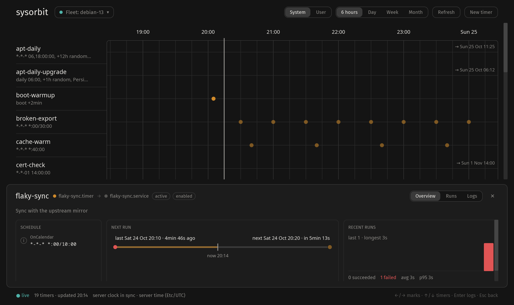
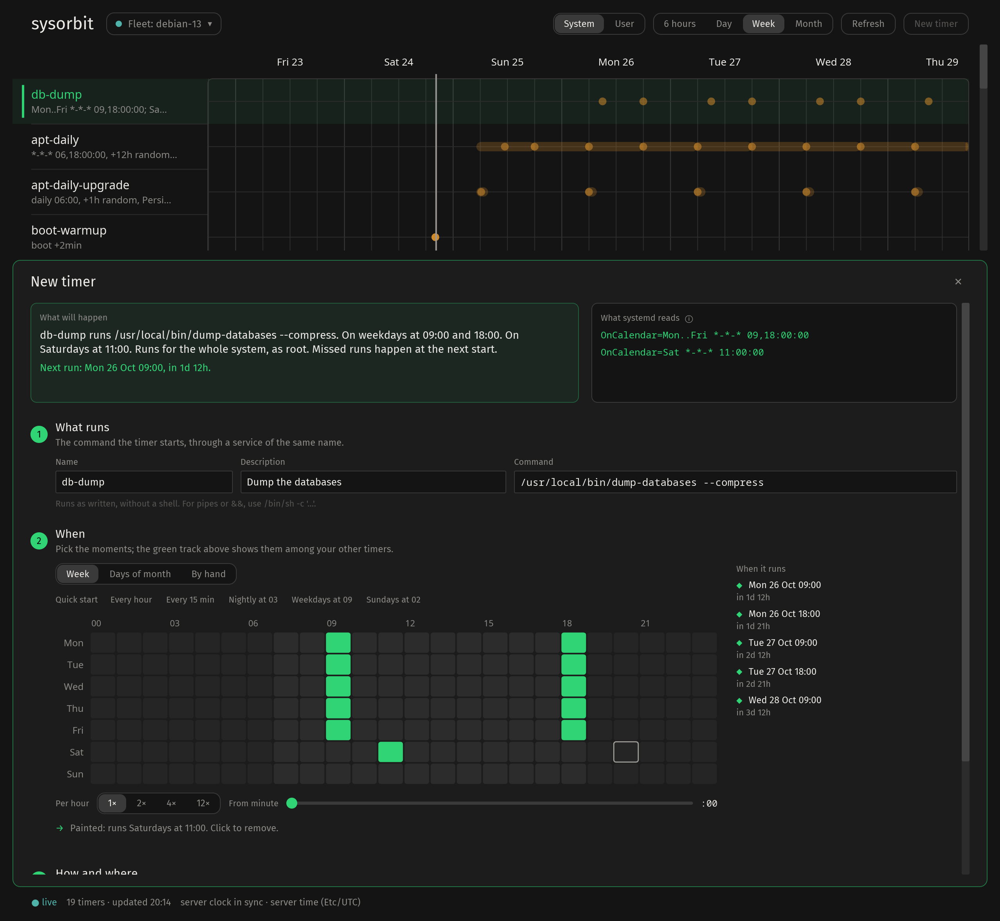

<p align="center">
  
</p>

<h1 align="center">sysorbit</h1>

A cross-platform desktop application for Linux, macOS, and Windows to visualize
systemd timers (239+) on local and remote Linux hosts. Its music-box timeline
brings schedules, past runs and upcoming triggers into one view.

Built with Rust and [iced](https://iced.rs).



Every timer is a track; runs and upcoming elapses are its notes. Select one for
its schedule, recent runs and journal logs.



New timers are composed rather than typed: paint the hours on the rhythm grid,
and a draft track shows when it will run among your other timers, as systemd
itself computes it.

## Features

- Browse system and user timers with live updates.
- Explore schedules, run history and journal logs.
- Create a timer and its service by painting its schedule, with a live preview
  among the existing timers and the unit files shown before they are installed.
- Connect to Linux hosts over SSH and switch between saved hosts.
- View the interface in English or Turkish.
- Keep privacy-preserving local logs for bug reports.

Linux supports both local and remote hosts. macOS and Windows connect to Linux
hosts over SSH. The application supports systemd 239 and newer, with reduced
schedule detail on older versions.

## Installation

Linux packages for x86_64 (DEB, RPM and Arch) are attached to each
[GitHub release](https://github.com/estnml/sysorbit/releases), with an
application menu entry and icon. See [Linux packaging](packaging/README.md) for
installation and build instructions. The AUR package is not published yet.
macOS and Windows currently require a source build or a CI binary.

## Build and run

With a stable Rust toolchain installed:

```sh
git clone https://github.com/estnml/sysorbit.git
cd sysorbit
cargo run --release
```

To open a remote host:

```sh
cargo run --release -- user@server.example.com
```

Remote connections use the local OpenSSH client and its configuration. Set up
key-based authentication or an SSH agent first; password prompts are not
supported. The remote host needs systemd, `journalctl`, `systemd-analyze` and
`systemd-stdio-bridge`. Journal access follows the connecting user's permissions.

## Development

```sh
cargo fmt --check
cargo clippy --all-targets -- -D warnings
cargo test
```

CI builds and tests all three platforms. Development binaries are attached as
artifacts to successful [GitHub Actions runs](https://github.com/estnml/sysorbit/actions).

The screenshots come from a host of the demo fleet in
[tests/fleet](tests/fleet/run.sh), never from a real machine. With the fleet
running, take them again after interface changes:

```sh
tests/fleet/run.sh
SYSORBIT_SCREENSHOTS=assets/screenshots cargo test readme_screenshots -- --ignored
```

See [LOGGING.md](LOGGING.md) for local diagnostics and privacy details, and
[TRANSLATING.md](TRANSLATING.md) to contribute a translation.

Created by [Esat Mustafa Namlı (@estnml)](https://github.com/estnml).

Licensed under the [MIT license](LICENSE).
